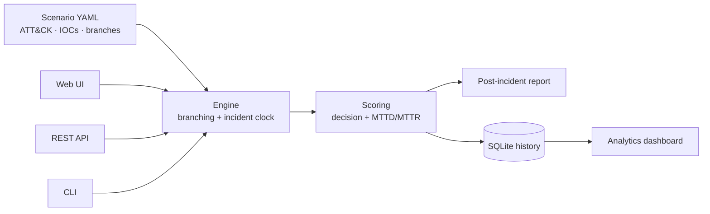

# IR-Sim

[](https://github.com/KarthikeyanSubramaniyam/ir-sim/actions/workflows/ci.yml)


A tabletop **cybersecurity incident-response simulator** for blue teams. It
replays realistic intrusions as branching event chains mapped to MITRE ATT&CK,
has the responder make detect / contain / eradicate / recover decisions under a
simulated incident clock, and scores those decisions against the NIST SP 800-61
lifecycle — on both **quality** and **speed** (MTTD / MTTC / MTTR). Every run is
recorded so a dashboard can track resilience over time.

> [!NOTE]
> **Safe by design.** IR-Sim is a *simulation*. It never generates real network
> traffic and never touches a live system — all events, IOCs and ATT&CK mappings
> are pre-scripted synthetic data, and every "automated recovery action" is a
> simulated state change. IOC values use documentation/reserved ranges
> (RFC 5737, `example.com`) so they can never match a real indicator.

---

## Contents

- [Features](#features)
- [Architecture](#architecture)
- [Quick start](#quick-start)
- [Usage](#usage)
- [Project structure](#project-structure)
- [How scoring works](#how-scoring-works)
- [Scenarios](#scenarios)
- [Development](#development)
- [License](#license)

## Features

- **MITRE ATT&CK mapping** on every event — technique ID, tactic, reference link
  — plus synthetic IOCs and the detection logic that fired.
- **Branching engine** — poor decisions change what happens next (e.g. a delayed
  ransomware containment lets the infection spread to a second host).
- **Response timing** — each action costs incident-clock minutes; MTTD / MTTC /
  MTTR are graded against per-scenario target SLAs.
- **Blended scoring** — decision quality (70%) and response speed (30%), with a
  per-phase breakdown and automatic gap analysis.
- **Analytics dashboard** — SQLite run history with dependency-free inline-SVG
  charts (score trend, per-phase strength, per-scenario averages, leaderboard).
- **Three interfaces** — a Flask web UI, a JSON REST API, and a CLI.
- **Author your own** — add scenarios as YAML files or straight from the UI
  (schema-validated before they're accepted).
- **Production-grade repo** — Docker image, GitHub Actions CI (ruff + pytest on
  Python 3.10–3.12), and a 28-test suite.

## Architecture



## Quick start

```bash
python -m venv .venv
source .venv/bin/activate          # Windows: .venv\Scripts\activate
pip install -e ".[dev]"

python app.py                      # http://127.0.0.1:5000
```

## Usage

### Command line

| Command | Description |
| --- | --- |
| `irsim list` | List scenarios and their ATT&CK coverage |
| `irsim play <scenario>` | Play interactively in the terminal |
| `irsim run <scenario> --strategy best` | Auto-play and print the full report |
| `irsim stats` | Aggregate statistics from the run database |
| `irsim serve` | Start the web server |

### REST API

| Method & path | Description |
| --- | --- |
| `GET /api/scenarios` | List scenarios |
| `POST /api/sessions` | Start a session → first step |
| `POST /api/sessions/<token>/choice` | Submit a decision → feedback + next step |
| `GET /api/sessions/<token>/report` | Final metrics for a finished session |
| `GET /api/stats` | Aggregate analytics |
| `GET /api/health` | Liveness probe |

```bash
curl -s localhost:5000/api/scenarios | jq '.[].id'
```

### Docker

```bash
docker build -t ir-sim .
docker run -p 8000:8000 ir-sim     # served by gunicorn
```

## Project structure

```
ir-sim/
├─ app.py · wsgi.py        # entry points (dev server / gunicorn)
├─ irsim/                  # application package
│  └─ web/                 # Flask factory, REST API, SVG charts
├─ scenarios/              # YAML scenario playbooks
├─ templates/ · static/    # web UI and dashboard
└─ tests/                  # pytest suite
```

The `irsim` package is organised by responsibility:

| Module | Responsibility |
| --- | --- |
| `models.py` | Dataclasses for scenarios, steps, options and sessions |
| `scenarios.py` | YAML loading and schema validation |
| `attack.py` | Embedded MITRE ATT&CK technique catalog |
| `engine.py` | Branching state machine and incident clock |
| `scoring.py` | Decision + timing scoring and gap analysis |
| `report.py` | Markdown post-incident report |
| `storage.py` | SQLite run persistence |
| `analytics.py` | Cross-run aggregation for the dashboard |
| `cli.py` | Command-line interface |
| `web/` | Flask application factory, REST API, inline-SVG charts |

## How scoring works

Each response option carries a `points` value (decision quality) and a
`time_cost` in minutes. The engine records when each milestone — `detected`,
`contained`, `recovered` — is first achieved by a sound decision, which yields
MTTD / MTTC / MTTR. Those are graded against the scenario's `targets`, and the
final **performance score** blends decision quality with response speed. Any
phase scoring below threshold, or SLA missed, is reported as a gap with a
recommendation.

## Scenarios

Five advanced scenarios ship with the tool:

| Scenario | Category | Key ATT&CK techniques |
| --- | --- | --- |
| Ransomware on a File Server | Malware / Impact | T1486, T1053.005, T1003 |
| Phishing to Foothold | Account compromise | T1566, T1621, T1114.003 |
| Malicious Insider | Exfiltration | T1567.002, T1530 |
| Volumetric DDoS | Availability | T1498, T1498.001 |
| Business Email Compromise | Fraud | T1566, T1534, T1114 |

Add your own from the web UI (**“+ Add your own scenario”**) or by dropping a
YAML file in `scenarios/`. See [CONTRIBUTING.md](CONTRIBUTING.md) for the schema.

## Development

```bash
make install    # pip install -e ".[dev]"
make test       # pytest
make lint       # ruff check .
make format     # ruff format .
```

CI runs `ruff` and `pytest` on Python 3.10–3.12 for every push and pull request.
See [CONTRIBUTING.md](CONTRIBUTING.md) and [SECURITY.md](SECURITY.md).

## License

Released under the [MIT License](LICENSE).
